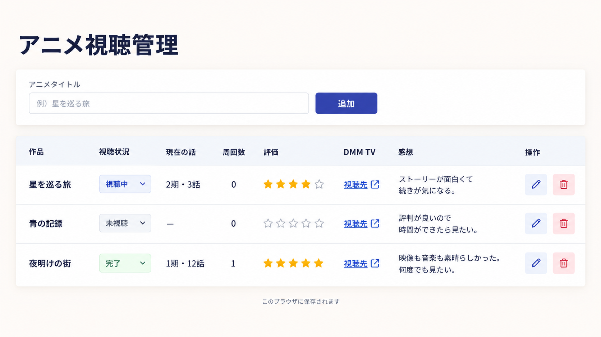
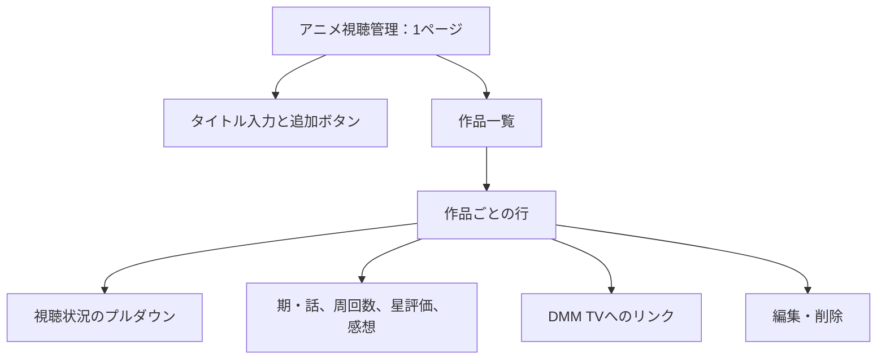
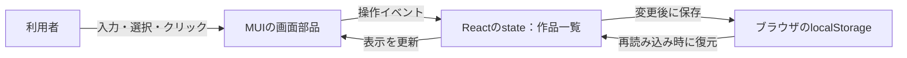
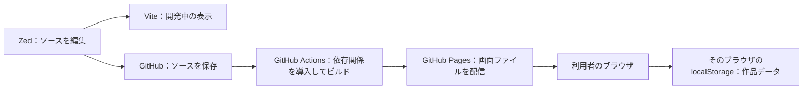

# アニメ視聴管理アプリ 設計

この文書は[要件定義.md](要件定義.md)を実現するための構成を示す。学習と制作のゴールは[授業の目的.md](授業の目的.md)を参照する。ここに書いた内容の実装・動作確認状況は[tasks.md](tasks.md)で確認する。

## 完成画面のイメージ

この画像は確認用の案。作品名と感想は架空の例で、画面の実装結果ではない。タイトルだけで登録し、各行で視聴状況を変更する形を示している。細かな配置や色は、学生が画像を確認した後に決める。

## 技術の役割

| 技術・場所 | 担当 |
| --- | --- |
| React | 作品一覧を `state` で保持し、操作に合わせて画面を更新する。 |
| TypeScript | 1作品のデータの型を定める。 |
| MUI | 入力欄、一覧、視聴状況のプルダウン、星評価などの画面部品を提供する。 |
| Tailwind CSS | 必要な余白や配置の調整に使う。 |
| Vite | 開発中の表示と公開用ファイルのビルドを担当する。 |
| `localStorage` | 同じブラウザに作品一覧を保存する。 |
| GitHub Actions・Pages | 公開時にビルド結果を配置し、アプリの画面を配信する。作品データは保存しない。 |

## データの形

1作品を1つのオブジェクトで表し、作品の配列を一覧として保持する。データベースのテーブルは作らない。

| 名前 | 型 | 初期値・条件 |
| --- | --- | --- |
| `id` | 文字列 | 作品を区別する識別子。新規登録時にUUIDv4を生成する。 |
| `title` | 文字列 | 空白を除いた文字が必要。 |
| `url` | 文字列 | 初期値は空。登録する場合は `https://` のURL。DMM TVの視聴先を想定。 |
| `status` | `unwatched` / `watching` / `completed` | 初期値は `unwatched`。表示名は未視聴／視聴中／完了。 |
| `season` | 正の整数または未設定 | 今見ている期。 |
| `episode` | 正の整数または未設定 | 今見ている話。 |
| `completedWatchCount` | 0以上の整数 | 初期値は0。全話を見終えた周回数。 |
| `rating` | 1〜5の整数または未設定 | 星評価。 |
| `comment` | 文字列 | 初期値は空。 |

期と話は対で扱い、片方だけ入力された場合は保存前に知らせる。視聴状況を「完了」に変えても期・話を消さない。周回数は視聴状況と自動連動させず、本人が記録する。

### 作品IDの採用理由

新規登録ごとに `crypto.randomUUID()` を呼び、その戻り値を `id` にする。アニメタイトルやURLはID生成に使わない。IDは一覧表示の `key` と、変更対象の作品を見分けるために使う。

個人利用・少数の作品登録ではUUIDv4の偶然の衝突確率が極めて低いため、初期版では追加の衝突検査を設けない。ただし、衝突が起きれば別の作品を区別できず、表示や状態変更に問題が生じ得る。「衝突しても問題ない」という意味ではない。利用規模や、取り違えが起きた場合の影響が大きくなるなら、保存先で一意性を検査し、衝突時に再生成する設計を検討する。同じタイトルの重複登録を禁止するかは、ID衝突とは別の要件として扱う。

## 画面と操作

画面URLは既存の `/mui-practice/` を使う。1ページに、タイトル、作品追加の入口、作品一覧を置く。一覧には作品名、視聴状況、期・話、周回数、評価、DMM TVリンク、感想、編集・削除の操作を表示する。長い感想などの見せ方は、画面を作る段階で学生と確認する。

作品追加ではタイトルだけで登録できる。一覧の各行の視聴状況はMUIのプルダウンで直接変更する。それ以外の項目は編集操作から変更する。削除は対象を確認してから実行する。MUIの具体的な部品と導入順は、各操作の前に公式ドキュメントを確認して学生と決める。

## データの流れと保存

### 初回のタイトル編集（項目33）

[初回の編集要件](要件定義.md#初回の編集範囲作品タイトル項目33)に対応し、変更予定の画面コードは `src/App.tsx` とする。

1. 各作品の行に「編集」ボタンを置く。
2. ボタンを押すと、その作品の現在のタイトルを入力欄に初期表示したMUIのダイアログを開く。
3. 編集対象のIDと入力中のタイトルを保持し、入力中は登録済みの作品一覧を変更しない。
4. 保存時に空欄・空白だけの入力を拒否し、IDが一致する作品のタイトルだけをReactの `state` で更新する。作品のIDと視聴状況、ほかの作品は保持する。
5. キャンセル時は入力中の変更を破棄し、作品一覧を更新せずダイアログを閉じる。

現在の作品一覧はReactの `state` のみで保持している。以下の `localStorage` による保存は後続の設計であり、初回のタイトル編集には含めない。この節も実装済みを意味しない。

起動時に `localStorage` に保存された作品一覧を読み、Reactの `state` に入れる。登録・編集・視聴状況変更・削除が起きたら、まず `state` を更新して画面へ反映し、その一覧を `localStorage` に保存する。保存先はMac上で利用したブラウザの保存領域で、GitHub PagesやDMM TVへ作品データは送らない。別の端末やブラウザには引き継がれない。

## 開発から公開まで

Zedでソースコードを編集し、Viteで開発中の画面を確認する。公開時はGitHubに送ったソースをGitHub Actionsがビルドし、GitHub Pagesが生成された画面ファイルを配信する。作品一覧の保存先は公開後も各ブラウザの `localStorage` である。

## 実装と確認の順序

1. Zedで既存の `mui-practice` を開き、`package.json` と `src` を確認する。
2. 開発サーバーで既存画面を確認し、MUI公式の部品一覧とインストール方法を確認する。
3. タイトルの登録と一覧表示を作り、Reactの `state` の動きを確かめる。
4. 学生と相談しながら残りの項目・操作を1種類ずつMUIの部品とともに加える。
5. 再読み込み後の保存、ビルド、公開表示を確認する。

AI が画面や機能のまとまりごとに編集し、学生がコードを読んで質問し、画面で結果を確認してから次へ進む。MUIの種類数は動作確認後に[tasks.md](tasks.md)へ記録する。

## 情報源

- [要件定義.md](要件定義.md)：今回の合意済み要件。
- [授業の03-3プロンプト](../03_3_プロンプト_〇〇管理アプリ作成_mui-practice.txt)：演習の進め方。
- [MUI公式コンポーネント一覧](https://mui.com/material-ui/all-components/)・[インストール手順](https://mui.com/material-ui/getting-started/installation/)：実装時に再確認する参照先。
- 学生との対話（2026-11-13）：個人利用を前提に、初期版はUUIDだけで作品IDを生成する判断。
- [UUIDの仕様（RFC 9562）](https://www.rfc-editor.org/rfc/rfc9562.html)：UUIDv4のランダム性、衝突の可能性と用途に応じた判断。
